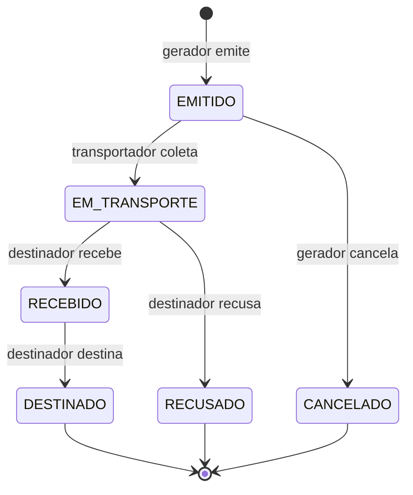
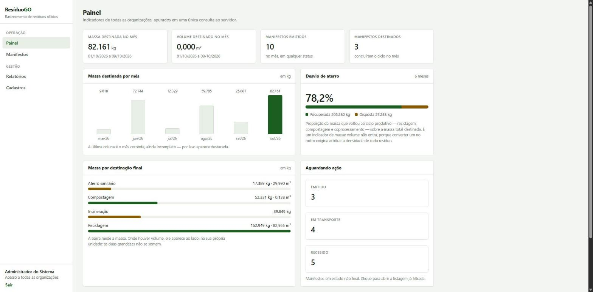

# ResíduoGO

Sistema de rastreamento de resíduos sólidos para organizações do estado de Goiás, baseado em web services.

Registra o ciclo completo de um lote de resíduo — gerador → transportador → destinador — em um manifesto digital que cada participante atualiza pela API. Projeto acadêmico (APS, 7º/8º semestre de Ciência da Computação, UNIP), com tema de gestão ambiental alinhado à ISO 14001.

O sistema expõe os dois estilos de web service exigidos:

- **REST** em `/api/v1`, documentado em `/docs` (Swagger)
- **SOAP** em `/soap/manifesto`, com contrato WSDL em `/soap/manifesto?wsdl`

## Requisitos

Python 3.11 ou superior (desenvolvido e testado no 3.13). Não é necessário instalar banco de dados: o sistema usa SQLite em arquivo.

## Como rodar

```bash
cd backend
py -3.13 -m venv .venv
.venv/Scripts/python.exe -m pip install -r requirements.txt

# carrega os dados de demonstração
.venv/Scripts/python.exe -m scripts.seed

# sobe o servidor
.venv/Scripts/python.exe -m uvicorn app.main:app --reload
```

Em outro terminal, o front-end:

```bash
cd frontend
npm install
npm run dev
```

Depois de subir:

| Endereço | O que é |
|---|---|
| http://localhost:5173 | a aplicação web |
| http://127.0.0.1:8000/docs | Swagger: documentação interativa do REST |
| http://127.0.0.1:8000/soap/manifesto?wsdl | contrato WSDL do serviço SOAP |
| http://127.0.0.1:8000/health | diagnóstico da aplicação, do banco e do cache das APIs externas |

O seed cria 6 organizações, 11 tipos de resíduo e 40 manifestos distribuídos pelos últimos seis meses, em todos os status e com algumas divergências de quantidade — para que a listagem e os relatórios tenham dados realistas. O sorteio usa semente fixa: os números não mudam entre execuções.

Para recarregar os dados do zero: `python -m scripts.seed --recriar`.

## Usuários de demonstração

Dados fictícios, criados pelo seed. Senha de todos os usuários comuns: `residuogo123`.

| Papel | Organização | E-mail |
|---|---|---|
| ADMIN | — | `admin@residuogo.com.br` (senha `admin12345`) |
| GERADOR | Indústria de Alimentos Cerrado S.A. (Anápolis) | `gerador1@residuogo.com.br` |
| GERADOR | Frigorífico Vale do Rio Verde Ltda. (Rio Verde) | `gerador2@residuogo.com.br` |
| TRANSPORTADOR | Transportes Ambientais Goiás Ltda. (Goiânia) | `transportador1@residuogo.com.br` |
| TRANSPORTADOR | Rodolimp Transporte de Resíduos ME (Aparecida de Goiânia) | `transportador2@residuogo.com.br` |
| DESTINADOR | Aterro Sanitário Central do Cerrado S.A. (Catalão) | `destinador1@residuogo.com.br` |
| DESTINADOR | Cooperativa de Reciclagem Renascer (Itumbiara) | `destinador2@residuogo.com.br` |

A transportadora **Rodolimp está com a licença ambiental vencida de propósito**: é com ela que se demonstra a regra RN04, que recusa a emissão de manifesto para participante sem licença válida — e, renovando a licença em Cadastros, que ela volta a ser aceita.

## Fluxo do manifesto



Cada transição é um POST para um sub-recurso que nomeia o evento — `/coleta`, `/recebimento`, `/recusa`, `/destinacao`, `/cancelamento` — e não um PUT com o novo status. O cliente descreve o que aconteceu; o servidor decide o status resultante. Assim a máquina de estados não pode ser contornada pela API.

As oito regras do sistema e onde cada uma é aplicada:

| Regra | O que exige | Onde |
|---|---|---|
| RN01 | só a organização do papel correto, e vinculada ao manifesto, executa a transição | `_exigir_papel` |
| RN02 | transição fora do diagrama é recusada com 409 | `_aplicar_transicao` |
| RN03 | cada transição grava uma movimentação, na mesma transação | `_aplicar_transicao` |
| RN04 | participantes ativos, com papel certo e licença válida | `emitir` |
| RN05 | quantidade recebida obrigatória; diferença acima de 5% marca divergência | `registrar_recebimento` |
| RN06 | recusa exige motivo; destinação exige tipo de tratamento | schemas de entrada |
| RN07 | o usuário só vê manifestos da própria organização; o ADMIN vê todos | `_exigir_visibilidade` |
| RN08 | ao menos um item, com quantidade positiva | schema `ManifestoCriar` |

As regras RN06 e RN08 ficam nos schemas de propósito: são exigências sobre o formato da requisição, e validadas ali o erro volta apontando o campo exato, no formato RFC 7807.

Todas as transições passam por uma única função, `_aplicar_transicao`, que é o único ponto do sistema que altera `manifesto.status`. É isso que faz com que RN02 e RN03 valham sempre, sem depender de cada rota se lembrar delas.

## Cliente SOAP

Com o servidor rodando, em outro terminal:

```bash
backend/.venv/Scripts/python.exe clients/soap_client.py RGO-2026-000003 11222333000181
```

O cliente usa `zeep`: ele lê o WSDL e monta a chamada sozinho, sem nenhum XML escrito no código. Informar um número inexistente ou um CNPJ que não participa do manifesto demonstra o tratamento de erro por SOAP Fault.

A aplicação web também consome o serviço: a tela **Consulta SOAP** monta o envelope, envia e mostra as duas mensagens XML trocadas. O detalhe de cada manifesto tem um atalho para ela.

## Integrações externas

| Rota | O que devolve |
|---|---|
| `GET /api/v1/localidades/municipios-go` | os 246 municípios de Goiás, da API de Localidades do IBGE |
| `GET /api/v1/localidades/cep/{cep}` | o endereço de um CEP, do ViaCEP, já com os nomes de campo do cadastro |

As duas servem ao cadastro de organizações: a lista do IBGE preenche o campo de município — e dela vem o código oficial de 7 dígitos, que é o que o sistema guarda — e o CEP preenche logradouro, bairro e município de uma vez.

Chamar um serviço de terceiro é o ponto em que uma API deixa de controlar a própria disponibilidade. A política, escrita uma vez em `integrations/externo.py` e aplicada igual às duas integrações:

1. toda chamada tem tempo limite (5 s);
2. falha de rede e erro 5xx são tentados mais uma vez; um 4xx não, porque a resposta seria a mesma;
3. a resposta boa fica em cache na memória — 30 dias para os municípios, 7 dias para cada CEP;
4. se a API cair, serve-se o último cache guardado, mesmo vencido;
5. só quando não há nada em cache o problema do terceiro chega ao usuário, como `503 SERVICO_EXTERNO_INDISPONIVEL`.

Toda resposta diz de onde veio o dado, no cabeçalho `X-Fonte`:

| `X-Fonte` | Significado |
|---|---|
| `api` | consultado agora na API externa |
| `cache` | cache dentro da validade; a API externa não foi chamada |
| `cache-expirado` | a API está fora do ar, e este é o último dado que havia |

Para ver o cache em ação, basta consultar os municípios duas vezes e comparar o `X-Fonte`. Com a lista já em cache, a rota continua respondendo mesmo com a máquina sem internet.

Um CEP inexistente é 404, não 503: o ViaCEP respondeu corretamente, e a resposta correta foi "não existe". Ele sinaliza isso de um jeito particular — HTTP 200 com `{"erro": "true"}` no corpo —, tratado em `integrations/viacep.py`.

Os CEPs e os códigos de município do seed são reais e conferidos nas duas APIs: consultar o CEP de qualquer organização cadastrada devolve exatamente o endereço que está no registro.

## Front-end

React com Vite e TypeScript, em `frontend/`. Consome a mesma API REST documentada no Swagger — nada no sistema é exclusivo da tela.



As demais telas estão em `docs/TELAS.md`, com legenda para cada uma.

| Tela | O que faz |
|---|---|
| Login | autentica e guarda o token; traz os acessos de demonstração para a apresentação |
| Painel | indicadores do mês, desvio de aterro, série dos seis meses, pendências e licenças a vencer |
| Manifestos | listagem com filtros no endereço da página, paginação e exportação em CSV |
| Emitir manifesto | só para o gerador; participantes e resíduos vêm dos catálogos da API |
| Detalhe | documento na tela, QR code, histórico e as ações permitidas ao usuário |
| `/qr/:token` | destino da etiqueta impressa: resolve o token e abre o manifesto |
| Relatórios | resumo do período por tipo, classe e destinação, com PDF |
| Cadastros | organizações, usuários e tipos de resíduo, com cadastro e alteração (apenas ADMIN) |
| Consulta SOAP | o status de um manifesto pelo web service SOAP, com o envelope enviado e o recebido |
| Trocar senha | troca da própria senha, exigindo a atual |

Sem biblioteca de componentes, de estado ou de gráficos: são poucas telas, e cada peça — o cliente HTTP, os dois hooks de carregamento e de ação, os gráficos em CSS — cabe em poucas dezenas de linhas que podem ser lidas e explicadas inteiras. A folha de estilo é única e usa o mesmo verde dos PDFs gerados pelo backend.

Três pontos da interface vale destacar, porque são decisões e não detalhes:

- **Quais botões aparecem** depende do status do manifesto e da organização do usuário — as mesmas duas condições da regra RN01. Esconder um botão é conveniência; quem recusa a operação é o servidor.
- **Os filtros ficam na URL.** Recarregar a página mantém o filtro, o botão voltar funciona, e o painel consegue apontar para `/manifestos?status=EMITIDO`.
- **PDF e CSV não são links.** As rotas exigem o cabeçalho `Authorization`, que o navegador não envia ao seguir um link comum; os arquivos são buscados como qualquer requisição e entregues a partir da memória.

## Testes

```bash
cd backend
.venv/Scripts/python.exe -m pytest
```

209 testes, cobrindo as validações de documento, o hash de senha e os tokens, as permissões por perfil, a manutenção dos cadastros (renovação de licença, desativação de usuário, troca de senha), as oito regras do manifesto (incluindo todas as transições que o diagrama recusa), o formato RFC 7807 de todas as respostas de erro, o serviço SOAP (consulta, faults e defesa contra XXE) e as integrações externas.

Nenhum teste acessa a internet: o `respx` intercepta as chamadas às APIs externas e devolve a resposta que o teste determinar — é assim que dá para provocar de propósito um tempo limite, um erro 500 e a indisponibilidade total do IBGE.

## Estrutura

```
residuogo/
├── backend/
│   ├── app/
│   │   ├── main.py          # cria a aplicação e registra tudo
│   │   ├── config.py        # configuração via .env
│   │   ├── database.py      # conexão, Base e o tipo de data em UTC
│   │   ├── enums.py         # enumerações do domínio
│   │   ├── models.py        # tabelas (SQLAlchemy)
│   │   ├── schemas.py       # contrato de entrada e saída (Pydantic)
│   │   ├── security.py      # bcrypt e JWT
│   │   ├── errors.py        # erros do domínio e respostas RFC 7807
│   │   ├── validacoes.py    # CNPJ e CEP
│   │   ├── dependencies.py  # sessão, autenticação e paginação
│   │   ├── paginacao.py     # montagem das listagens paginadas
│   │   ├── integrations/    # IBGE, ViaCEP, cache e política de falha
│   │   ├── routers/         # rotas REST
│   │   ├── services/        # regras de negócio
│   │   └── soap/            # envelope, WSDL e rota do serviço SOAP
│   ├── scripts/             # seed, contratos e trechos para o relatório
│   └── tests/
├── clients/soap_client.py   # consumidor do serviço SOAP (zeep)
├── docs/                    # insumos do trabalho escrito (ver adiante)
└── frontend/
    └── src/
        ├── App.tsx          # rotas
        ├── estilos.css      # folha de estilo única
        ├── formatos.ts      # número, data, CNPJ e CEP em formato brasileiro
        ├── rotulos.ts       # como cada enumeração é escrita na tela
        ├── sessao.ts        # contrato da sessão e hooks de leitura
        ├── useCarregamento.ts  # consulta à API, com cancelamento
        ├── useAcao.ts       # ações que escrevem, com erro e botão travado
        ├── api/             # cliente HTTP, rotas e tipos do contrato
        ├── componentes/     # moldura, campos, etiquetas e gráficos
        └── telas/           # uma por tela do sistema
```

As regras de negócio ficam em `services/`, nunca nos routers: é o que permite que REST e SOAP compartilhem exatamente o mesmo comportamento, diferindo apenas no formato da mensagem.

## Tratamento de erros

Toda resposta de erro segue a [RFC 7807](https://datatracker.ietf.org/doc/html/rfc7807), com o tipo `application/problem+json`:

```json
{
  "type": "https://residuogo.example/erros/licenca-vencida",
  "title": "Licença ambiental vencida",
  "status": 422,
  "detail": "A licença ambiental de Rodolimp Transporte de Resíduos ME venceu em 30/06/2025 e por isso ela não pode atuar como transportador.",
  "instance": "/api/v1/manifestos",
  "codigo": "LICENCA_VENCIDA",
  "erros": []
}
```

O campo `codigo` permite ao front-end reagir ao erro sem depender do texto da mensagem, e `erros[]` lista as falhas campo por campo nos erros de validação. O serviço SOAP relata os mesmos erros como SOAP Fault, usando o mesmo vocabulário de códigos.

## Insumos do trabalho escrito

Tudo o que o relatório precisa está em `docs/`, e a maior parte é gerada a partir do próprio código — o que evita que o documento envelheça em relação ao sistema.

| Arquivo | O que é | Como se gera |
|---|---|---|
| `MAPA_DE_DESENVOLVIMENTO.md` | decisões de arquitetura com o motivo de cada uma, problemas encontrados (sintoma, causa e correção) e como cada entrega foi verificada | escrito à mão, durante o desenvolvimento |
| `TRECHOS_DE_CODIGO.md` | os trechos de código escolhidos para o relatório impresso, com a contagem de linhas | `python -m scripts.exportar_trechos` |
| `DIAGRAMAS.md` | os cinco diagramas do sistema, em Mermaid | escrito à mão; as imagens saem de <https://mermaid.live> |
| `TELAS.md` | as sete capturas de tela, com legenda sugerida para cada figura | capturas do sistema rodando |
| `openapi.json` e `manifesto.wsdl` | os contratos dos dois web services | `python -m scripts.exportar_docs` |
| `imagens/` | os cinco diagramas e as sete telas, em arquivo | — |

Os dois scripts rodam a partir da pasta `backend` e não precisam do servidor no ar.

### Os trechos de código no relatório

O relatório de código tem limite de 10 páginas em Arial 12 com espaçamento 1,5 — cerca de 380 linhas. Como o projeto é maior que isso, os trechos que vão para o papel ficam marcados no próprio código-fonte:

```python
# APS-TRECHO 3: Erros no formato RFC 7807
...
# APS-FIM
```

`scripts/exportar_trechos.py` recolhe essas marcas e monta `docs/TRECHOS_DE_CODIGO.md`, avisando se a soma passar do limite. São **seis trechos, 299 linhas**: as rotas REST, a máquina de estados, o tratamento de erro RFC 7807, o serviço SOAP escrito à mão, o cliente `zeep` e a integração externa com cache.

A escolha privilegia os dois web services, que são o tema do trabalho. O front-end aparece pelas capturas de tela, não por código.

## Situação do desenvolvimento

| Fase | Entrega | Situação |
|---|---|---|
| F1 | Base: models, autenticação JWT, erros RFC 7807, cadastros, `/health`, SOAP | concluída |
| F2 | Manifesto, itens, máquina de estados, histórico, regras RN01–RN08 | concluída |
| F3 | IBGE e ViaCEP com cache em memória e queda tratada | concluída |
| F4 | PDF do manifesto com QR code, relatórios em PDF e CSV, painel de indicadores | concluída |
| F5 | Front-end em React: login, painel, manifestos, relatórios e cadastros | concluída |
| F6 | Acabamento: diagramas, capturas de tela e trechos de código para o relatório | concluída |
| F7 | Alteração dos cadastros, troca de senha e consulta SOAP pela aplicação web | concluída |

O desenvolvimento está concluído. O que resta é o trabalho escrito, que não depende do código: a proposta para o coordenador, o capítulo sobre fundamentos de web services, a dissertação sobre formação e interdisciplinaridade, a bibliografia e a ficha da APS.

O serviço SOAP e o cliente `zeep` já estão funcionando desde a F1, por serem o ponto de maior risco técnico do projeto.
