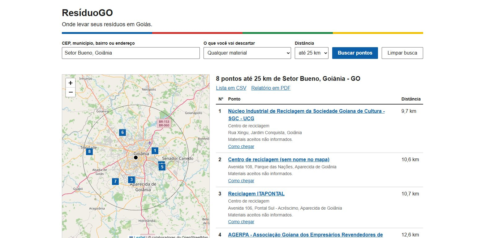
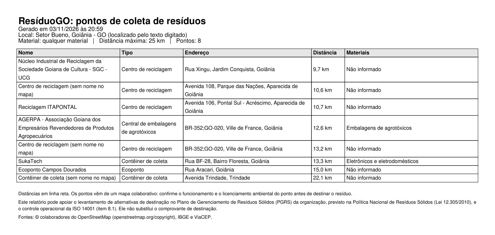

# ResíduoGO

Consulta de pontos de coleta de resíduos no estado de Goiás. A pessoa digita um CEP, município, bairro ou endereço, ou clica no mapa, e vê os pontos mais próximos em uma lista e no mapa.

Trabalho de APS do curso de Ciência da Computação da UNIP. O enunciado pede web services ligados à gestão ambiental, dentro de Goiás, e uma aplicação que os consuma.



## Como funciona

O projeto tem um web service REST próprio, que busca os dados em APIs públicas no momento da consulta, e uma página web que consome esse serviço. Nenhum dado de endereço ou de ponto de coleta fica guardado no código: tudo vem das APIs, e o que já foi consultado fica num cache (veja "Quando uma API externa cai").

| API externa | Para que é usada |
|---|---|
| IBGE Localidades | municípios de Goiás, usados nas sugestões do campo de busca |
| IBGE Malhas | contorno oficial de Goiás, desenhado no mapa |
| ViaCEP | endereço a partir do CEP |
| Nominatim (OpenStreetMap) | coordenadas de um endereço, bairro ou lugar; os pontos de coleta em volta; o estado de um ponto clicado no mapa |

Uma explicação mais completa, voltada para a apresentação, está em [docs/FUNCIONAMENTO.md](docs/FUNCIONAMENTO.md).

## Como rodar

Precisa do Python 3.10 ou mais novo (testado no 3.11). No PowerShell, a partir da raiz do projeto:

```
python -m venv .venv
.venv\Scripts\activate
pip install -r requirements.txt
uvicorn app.main:app --reload
```

- Página: http://127.0.0.1:8000
- Documentação da API: http://127.0.0.1:8000/docs

## Na página

- O campo de busca aceita CEP, município, bairro ou endereço. O CEP busca sozinho quando fica completo, e o município, ao ser escolhido nas sugestões. O resto busca com Enter ou com o botão.
- O título do resultado mostra o lugar que foi entendido, para conferir.
- Clicar no mapa procura a partir daquele lugar, desde que seja dentro de Goiás.
- Mudar o material ou a distância refaz a busca atual.
- Passar o mouse em um ponto da lista destaca o ponto no mapa, e clicar em um marcador destaca o ponto na lista.
- "Lista em CSV" e "Relatório em PDF" baixam a busca que está na tela.
- "Limpar busca" volta a página ao início.

## API

| Rota | O que faz |
|---|---|
| `GET /api/pontos` | pontos perto de um local ou ponto no mapa |
| `GET /api/pontos.csv` | a mesma busca, em planilha |
| `GET /api/pontos.pdf` | a mesma busca, em relatório PDF |
| `GET /api/municipios` | municípios de Goiás, com a região |
| `GET /api/materiais` | materiais aceitos no filtro |
| `GET /api/goias` | contorno oficial de Goiás, em GeoJSON |

Parâmetros de `/api/pontos`, iguais no CSV e no PDF: `local` (CEP, município, bairro ou endereço) ou `lat` e `lon`, mais `raio_km` (de 1 a 50, padrão 10) e `material`.

```
GET /api/pontos?lat=-16.59&lon=-49.33&raio_km=2&material=eletronicos
```

```json
{
  "origem": {
    "descricao": "Ponto escolhido no mapa",
    "latitude": -16.59,
    "longitude": -49.33,
    "precisao": "mapa"
  },
  "raio_km": 2,
  "material": "eletronicos",
  "total": 1,
  "pontos": [
    {
      "nome": "SukaTech",
      "tipo": "Contêiner de coleta",
      "endereco": "Rua BF-28, Bairro Floresta, Goiânia",
      "latitude": -16.5919271,
      "longitude": -49.3362115,
      "distancia_km": 0.7,
      "materiais": [{ "chave": "eletronicos", "rotulo": "Eletrônicos e eletrodomésticos" }],
      "telefone": "",
      "horario": ""
    }
  ],
  "fora_do_raio": false
}
```

As respostas de sucesso em `/api` trazem `Cache-Control: public, max-age=3600`, e as de erro, `no-store`.

Se não houver nenhum ponto no raio, a resposta traz os 3 mais próximos em até 250 km, com `fora_do_raio` igual a `true`. Para achá-los, a busca aumenta a área aos poucos (50, 100 e 250 km) e junta o que encontrou em cada uma.

O relatório em PDF traz a data, o local entendido, o material, o raio, a tabela dos pontos e as fontes dos dados, com a atribuição exigida pela licença do OpenStreetMap:



Os erros seguem a RFC 7807 e têm a mensagem em `detail`:

| Situação | Resposta |
|---|---|
| CEP, distância ou material inválido, CEP ou ponto fora de Goiás | 422 |
| CEP ou lugar não encontrado em Goiás | 404 |
| API externa necessária fora do ar, sem resposta guardada | 503 |

## Quando uma API externa cai

1. As respostas das APIs ficam guardadas em um cache em arquivo (`cache.db`): 30 dias para municípios, CEP, coordenadas e contorno, e 1 dia para os pontos. Uma busca repetida não consulta de novo.
2. Se uma API não responde, a busca usa a última resposta guardada, mesmo vencida.
3. Sem resposta e sem nada guardado, o serviço responde 503 com o nome da API que falhou.
4. Sem o IBGE, o campo continua aceitando o nome da cidade: o Nominatim a encontra como um lugar qualquer.

Antes de uma apresentação, vale fazer uma vez as buscas que serão mostradas: elas ficam no cache e não dependem mais das APIs. O mapa (a biblioteca Leaflet e as imagens) continua precisando de internet.

## De onde vêm os pontos

- **OpenStreetMap, pelo Nominatim:** a cada busca, o serviço pergunta ao Nominatim pelos lugares marcados como ponto de reciclagem (`amenity=recycling`) dentro da área da busca e pelos ecopontos do estado, encontrados pelo nome. O parâmetro `extratags` traz junto os materiais aceitos, o horário e o telefone, quando o mapa tem essas informações.
- **Só Goiás:** o Nominatim informa o estado de cada lugar, e só ficam os de Goiás. O contorno desenhado no mapa vem da API de malhas do IBGE.
- **O que fica de fora:** aterros, lixões e estações de transbordo que não são ecopontos, porque não recebem entrega de quem procura um ponto, e áreas marcadas como privadas. As centrais de embalagens de agrotóxicos são reconhecidas pelo nome.
- **Limitações:** o mapa é aberto e feito por voluntários, então pode faltar ponto e a maioria não informa os materiais aceitos. Nesses casos, a tela mostra "Materiais aceitos não informados". O Nominatim é um buscador e devolve no máximo 50 lugares por consulta. Nas distâncias da busca normal (até 50 km), isso não fez diferença nos testes. Numa área grande, porém, os muitos pontos do DF ocupam esse limite e pontos de Goiás podem ficar de fora; por isso a busca dos mais próximos começa pelas áreas menores.
- **Outras fontes:** não foi encontrada API pública com os pontos de coleta de Goiás. O portal de dados abertos do estado não tem esses dados, nem a Prefeitura de Goiânia, e as entidades de logística reversa só têm buscadores nos próprios sites. Um ponto que esteja faltando pode ser cadastrado no OpenStreetMap e passa a aparecer na busca: o Nominatim se atualiza em minutos, e o cache do sistema guarda os pontos por até 1 dia.

As cores dos materiais na tela seguem a Resolução CONAMA 275/2001. Os itens que ela não cobre aparecem em cinza.

## Relação com a gestão ambiental

Dar o destino correto aos resíduos é um dos controles mais comuns na gestão ambiental de uma organização, tema da família ISO 14000. O ResíduoGO ajuda empresas e moradores a encontrar onde entregar cada tipo de resíduo. O relatório em PDF e a lista em CSV deixam as opções registradas para quem cuida disso na organização: o PDF lembra que pode apoiar o levantamento de alternativas de destinação no Plano de Gerenciamento de Resíduos Sólidos (PGRS), previsto na Lei 12.305/2010, e o controle operacional da ISO 14001.

## Testes

```
python -m pytest
```

Os testes não usam a internet: as APIs externas são simuladas.

## Estrutura

```
app/
  main.py              monta a aplicação: rotas, erros e a página
  config.py            endereços, prazos e tempos limite
  erros.py             respostas de erro (RFC 7807)
  rotas/
    api.py             as 6 rotas do web service (JSON, CSV e PDF)
    exportacao.py      monta a planilha CSV e o relatório em PDF
    schemas.py         formato das respostas, usado também em /docs
  servicos/
    localizacao.py     entende o local digitado ou clicado
    pontos.py          pede os pontos, converte, filtra e ordena
    materiais.py       materiais e etiquetas do OpenStreetMap
    geo.py             distância (Haversine) e retângulos de busca
  apis/
    ibge.py            municípios e contorno de Goiás
    viacep.py          endereço do CEP
    nominatim.py       coordenadas, pontos em volta e estado de um lugar
    cache.py           chamada HTTP com tempo limite e cache em SQLite
web/                   página (HTML, CSS e JavaScript)
tests/
docs/                  funcionamento, diagramas e telas
```

O código fica em três camadas, e cada uma só chama a de baixo: as rotas chamam os serviços, os serviços chamam as APIs, e toda consulta a uma API passa pelo cache. A única exceção é o contorno de Goiás, que não tem regra nenhuma e vai da API do IBGE direto para a rota.
