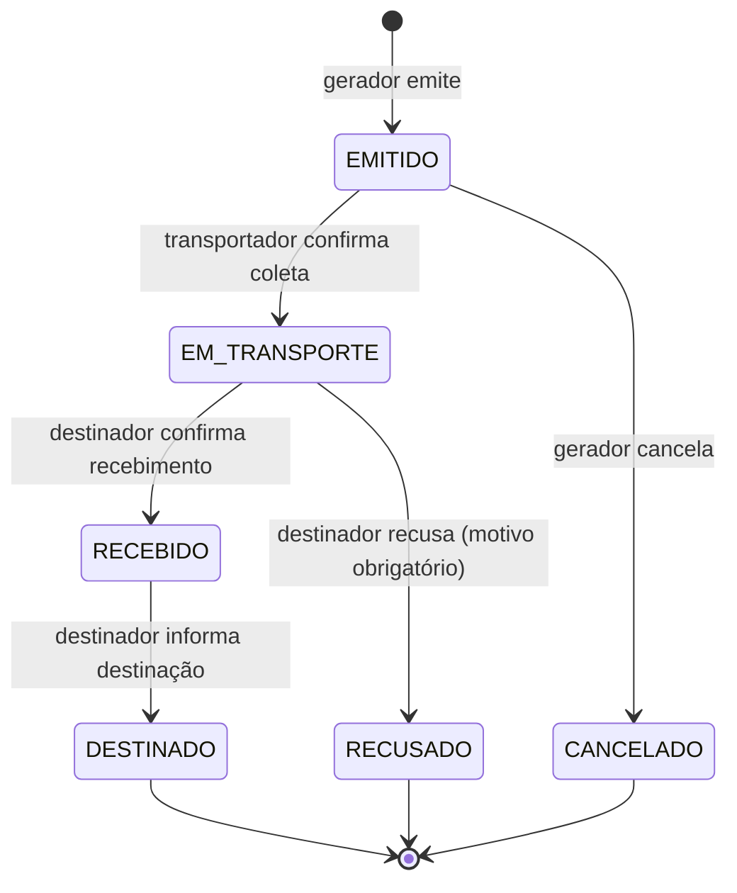

# ResíduoGO

Sistema de rastreamento de resíduos sólidos para organizações do estado de Goiás, baseado em web services.

Registra o ciclo completo de um lote de resíduo — gerador → transportador → destinador — em um manifesto digital que cada participante atualiza pela API. Projeto acadêmico (APS, 7º/8º semestre de Ciência da Computação, UNIP), com tema de gestão ambiental alinhado à ISO 14001.

O sistema expõe os dois estilos de web service exigidos:

- **REST** em `/api/v1`, documentado em `/docs` (Swagger)
- **SOAP** em `/soap/manifesto`, com contrato WSDL em `/soap/manifesto?wsdl`

## Requisitos

Python 3.11 ou superior (desenvolvido e testado no 3.13). Não é necessário instalar banco de dados: o sistema usa SQLite em arquivo.

## Como rodar

```bash
cd backend
py -3.13 -m venv .venv
.venv/Scripts/python.exe -m pip install -r requirements.txt

# carrega os dados de demonstração
.venv/Scripts/python.exe -m scripts.seed

# sobe o servidor
.venv/Scripts/python.exe -m uvicorn app.main:app --reload
```

Depois de subir:

| Endereço | O que é |
|---|---|
| http://127.0.0.1:8000/docs | Swagger: documentação interativa do REST |
| http://127.0.0.1:8000/soap/manifesto?wsdl | contrato WSDL do serviço SOAP |
| http://127.0.0.1:8000/health | diagnóstico da aplicação e do banco |

O seed cria 6 organizações, 11 tipos de resíduo e 40 manifestos distribuídos pelos últimos seis meses, em todos os status e com algumas divergências de quantidade — para que a listagem e os relatórios tenham dados realistas. O sorteio usa semente fixa: os números não mudam entre execuções.

Para recarregar os dados do zero: `python -m scripts.seed --recriar`.

## Usuários de demonstração

Dados fictícios, criados pelo seed. Senha de todos os usuários comuns: `residuogo123`.

| Papel | Organização | E-mail |
|---|---|---|
| ADMIN | — | `admin@residuogo.com.br` (senha `admin12345`) |
| GERADOR | Indústria de Alimentos Cerrado S.A. (Anápolis) | `gerador1@residuogo.com.br` |
| GERADOR | Frigorífico Vale do Rio Verde Ltda. (Rio Verde) | `gerador2@residuogo.com.br` |
| TRANSPORTADOR | Transportes Ambientais Goiás Ltda. (Goiânia) | `transportador1@residuogo.com.br` |
| TRANSPORTADOR | Rodolimp Transporte de Resíduos ME (Aparecida de Goiânia) | `transportador2@residuogo.com.br` |
| DESTINADOR | Aterro Sanitário Central do Cerrado S.A. (Catalão) | `destinador1@residuogo.com.br` |
| DESTINADOR | Cooperativa de Reciclagem Renascer (Itumbiara) | `destinador2@residuogo.com.br` |

A transportadora **Rodolimp está com a licença ambiental vencida de propósito**: é com ela que se demonstra a regra RN04, que recusa a emissão de manifesto para participante sem licença válida.

## Fluxo do manifesto



Cada transição é um POST para um sub-recurso que nomeia o evento — `/coleta`, `/recebimento`, `/recusa`, `/destinacao`, `/cancelamento` — e não um PUT com o novo status. O cliente descreve o que aconteceu; o servidor decide o status resultante. Assim a máquina de estados não pode ser contornada pela API.

As oito regras do sistema e onde cada uma é aplicada:

| Regra | O que exige | Onde |
|---|---|---|
| RN01 | só a organização do papel correto, e vinculada ao manifesto, executa a transição | `_exigir_papel` |
| RN02 | transição fora do diagrama é recusada com 409 | `_aplicar_transicao` |
| RN03 | cada transição grava uma movimentação, na mesma transação | `_aplicar_transicao` |
| RN04 | participantes ativos, com papel certo e licença válida | `emitir` |
| RN05 | quantidade recebida obrigatória; diferença acima de 5% marca divergência | `registrar_recebimento` |
| RN06 | recusa exige motivo; destinação exige tipo de tratamento | schemas de entrada |
| RN07 | o usuário só vê manifestos da própria organização; o ADMIN vê todos | `_exigir_visibilidade` |
| RN08 | ao menos um item, com quantidade positiva | schema `ManifestoCriar` |

As regras RN06 e RN08 ficam nos schemas de propósito: são exigências sobre o formato da requisição, e validadas ali o erro volta apontando o campo exato, no formato RFC 7807.

Todas as transições passam por uma única função, `_aplicar_transicao`, que é o único ponto do sistema que altera `manifesto.status`. É isso que faz com que RN02 e RN03 valham sempre, sem depender de cada rota se lembrar delas.

## Cliente SOAP

Com o servidor rodando, em outro terminal:

```bash
backend/.venv/Scripts/python.exe clients/soap_client.py RGO-2026-000001 11222333000181
```

O cliente usa `zeep`: ele lê o WSDL e monta a chamada sozinho, sem nenhum XML escrito no código. Informar um número inexistente ou um CNPJ que não participa do manifesto demonstra o tratamento de erro por SOAP Fault.

## Testes

```bash
cd backend
.venv/Scripts/python.exe -m pytest
```

140 testes, cobrindo as validações de documento, o hash de senha e os tokens, as permissões por perfil, as oito regras do manifesto (incluindo todas as transições que o diagrama recusa), o formato RFC 7807 de todas as respostas de erro e o serviço SOAP (consulta, faults e defesa contra XXE).

## Estrutura

```
residuogo/
├── backend/
│   ├── app/
│   │   ├── main.py          # cria a aplicação e registra tudo
│   │   ├── config.py        # configuração via .env
│   │   ├── database.py      # conexão, Base e o tipo de data em UTC
│   │   ├── enums.py         # enumerações do domínio
│   │   ├── models.py        # tabelas (SQLAlchemy)
│   │   ├── schemas.py       # contrato de entrada e saída (Pydantic)
│   │   ├── security.py      # bcrypt e JWT
│   │   ├── errors.py        # erros do domínio e respostas RFC 7807
│   │   ├── validacoes.py    # CNPJ e CEP
│   │   ├── dependencies.py  # sessão, autenticação e paginação
│   │   ├── paginacao.py     # montagem das listagens paginadas
│   │   ├── routers/         # rotas REST
│   │   ├── services/        # regras de negócio
│   │   └── soap/            # envelope, WSDL e rota do serviço SOAP
│   ├── scripts/             # seed e exportação dos contratos
│   └── tests/
├── clients/soap_client.py   # consumidor do serviço SOAP (zeep)
├── docs/                    # openapi.json e WSDL exportados
└── frontend/                # (fase 5)
```

As regras de negócio ficam em `services/`, nunca nos routers: é o que permite que REST e SOAP compartilhem exatamente o mesmo comportamento, diferindo apenas no formato da mensagem.

## Tratamento de erros

Toda resposta de erro segue a [RFC 7807](https://datatracker.ietf.org/doc/html/rfc7807), com o tipo `application/problem+json`:

```json
{
  "type": "https://residuogo.example/erros/licenca-vencida",
  "title": "Licença ambiental vencida",
  "status": 422,
  "detail": "A licença ambiental de Rodolimp Transporte de Resíduos ME venceu em 30/06/2025 e por isso ela não pode atuar como transportador.",
  "instance": "/api/v1/manifestos",
  "codigo": "LICENCA_VENCIDA",
  "erros": []
}
```

O campo `codigo` permite ao front-end reagir ao erro sem depender do texto da mensagem, e `erros[]` lista as falhas campo por campo nos erros de validação. O serviço SOAP relata os mesmos erros como SOAP Fault, usando o mesmo vocabulário de códigos.

## Insumos do trabalho escrito

```bash
cd backend
.venv/Scripts/python.exe -m scripts.exportar_docs
```

Gera `docs/openapi.json` e `docs/manifesto.wsdl` a partir do próprio código, sem precisar do servidor no ar.

## Situação do desenvolvimento

| Fase | Entrega | Situação |
|---|---|---|
| F1 | Base: models, autenticação JWT, erros RFC 7807, cadastros, `/health`, SOAP | concluída |
| F2 | Manifesto, itens, máquina de estados, histórico, regras RN01–RN08 | concluída |
| F3 | IBGE e ViaCEP com cache | a fazer |
| F4 | PDF com QR code, CSV, dashboard | a fazer |
| F5 | Front-end | a fazer |
| F6 | README final, diagramas e prints em `docs/` | a fazer |

O serviço SOAP e o cliente `zeep` já estão funcionando desde a F1, por serem o ponto de maior risco técnico do projeto.
