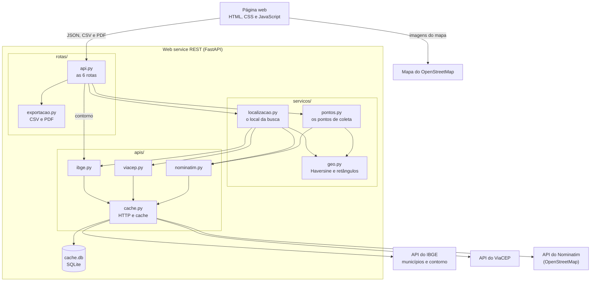
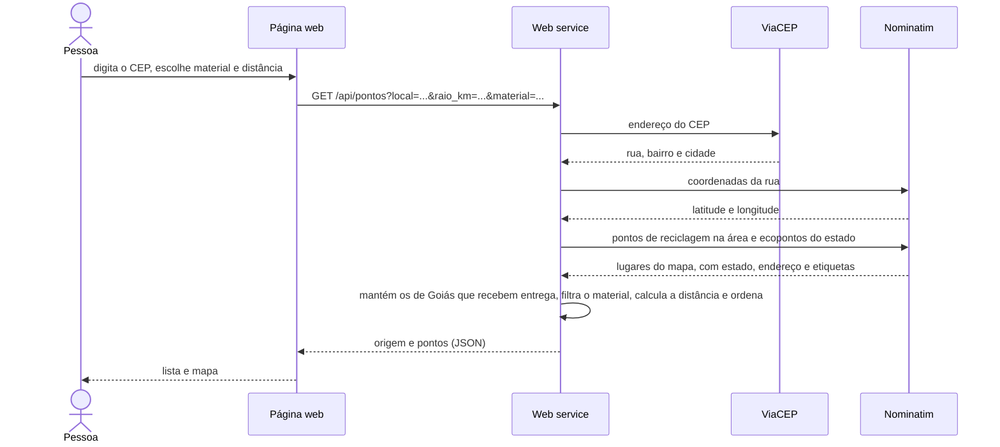
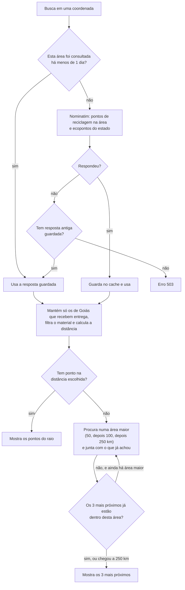
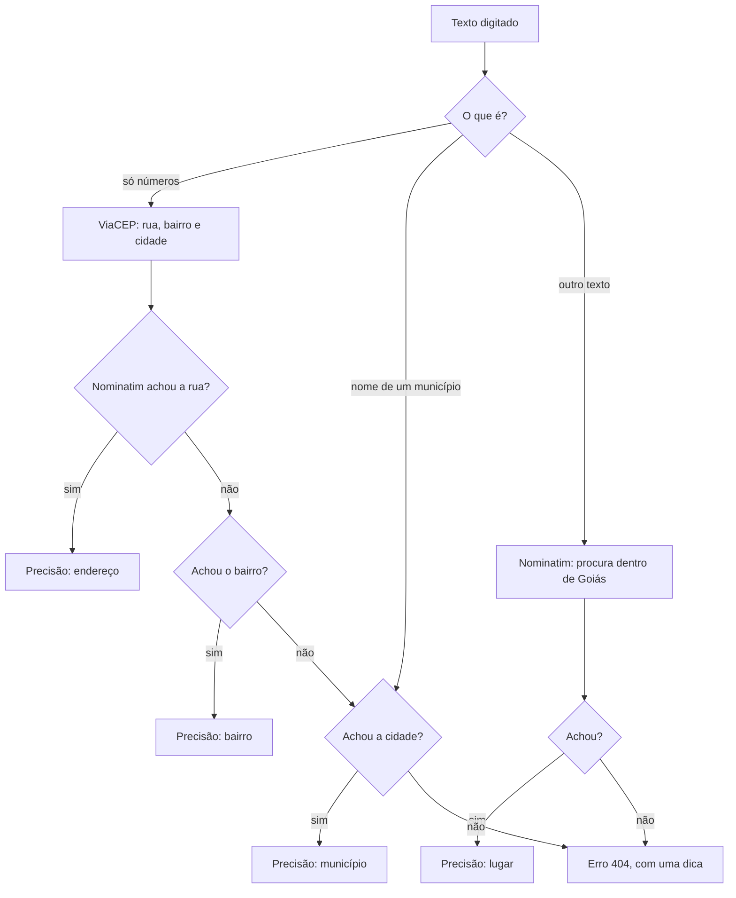

# Diagramas

Em Mermaid: o GitHub desenha direto, e em [mermaid.live](https://mermaid.live) dá para exportar a imagem.

## Componentes

Cada camada só chama a de baixo. A exceção é o contorno de Goiás, que vai da API do IBGE direto para a rota.

## Busca por CEP

## De onde vêm os pontos

As áreas menores vêm primeiro porque, numa área grande, os muitos pontos do DF ocupam o limite de 50 resultados do Nominatim e pontos de Goiás podem ficar de fora.

## Do texto digitado até as coordenadas

