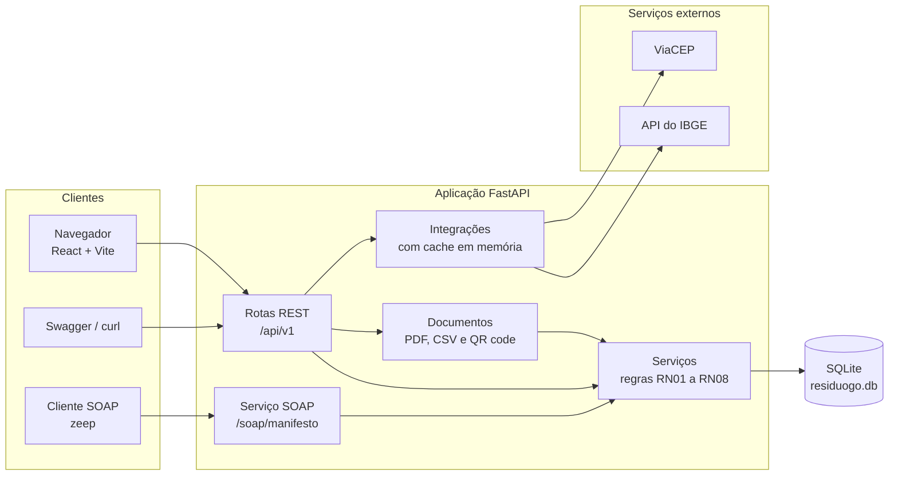
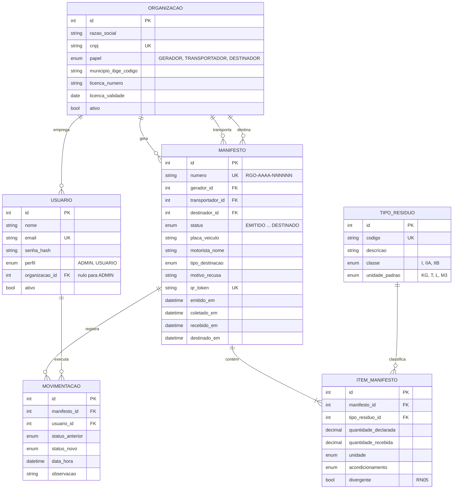
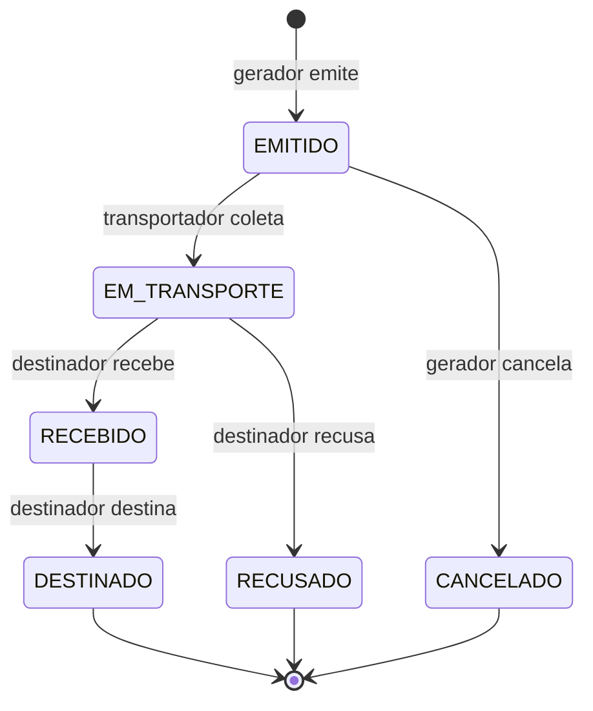
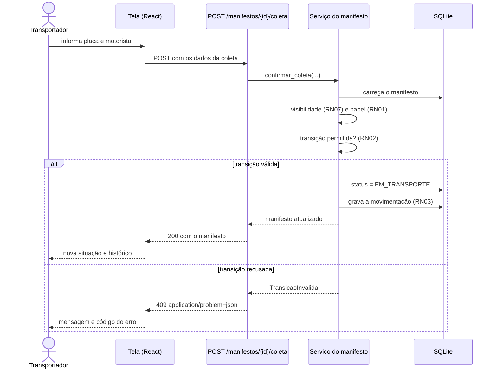
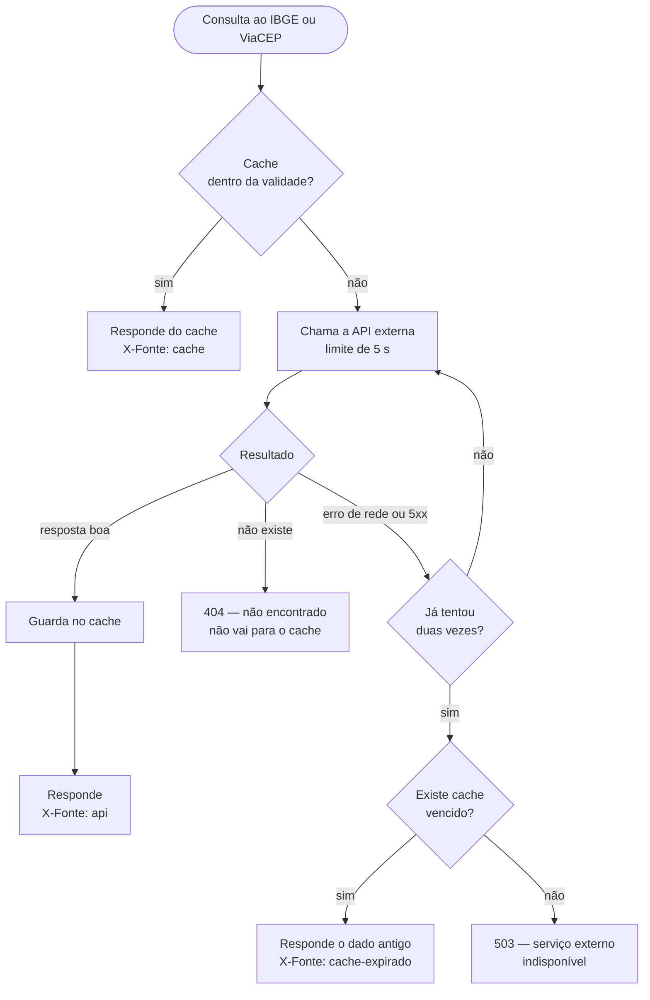

# Diagramas do ResíduoGO

Os cinco diagramas do sistema, escritos em [Mermaid](https://mermaid.js.org).
O código de cada um está logo abaixo da figura correspondente e é a fonte de
verdade: as imagens em `imagens/` foram exportadas destes blocos.

**Como ver e exportar.** O GitHub e o VS Code (painel de pré-visualização do
Markdown) desenham os diagramas direto deste arquivo. Para gerar uma imagem
nova — depois de mudar alguma coisa no sistema —, cole o bloco em
<https://mermaid.live> e use *Actions → PNG*.

---

## 1. Arquitetura

> Imagem: `imagens/diagrama-1-arquitetura.png`

Quem fala com quem. Os dois web services exigidos pelo trabalho — REST e
SOAP — estão na mesma aplicação e compartilham a camada de serviços, que é
onde moram as regras de negócio. É isso que impede os dois de divergirem: um
manifesto consultado por SOAP passou pelas mesmas regras de um consultado por
REST.

---

## 2. Modelo de dados

> Imagem: `imagens/diagrama-2-modelo-de-dados.png`

Seis tabelas. As três ligações entre `manifesto` e `organizacao` são os três
papéis do ciclo do resíduo — gerador, transportador e destinador —, e é por
elas que a regra de visibilidade (RN07) decide o que cada usuário enxerga.

A tabela `movimentacao` só recebe inserções: é o histórico de auditoria exigido
pela regra RN03.

---

## 3. Ciclo de vida do manifesto

> Imagem: `imagens/diagrama-3-ciclo-do-manifesto.png`

A máquina de estados. Cada seta diz quem tem autoridade para percorrê-la
(regra RN01), e o que não está desenhado é recusado com `409` (RN02). Os três
estados finais não admitem nenhuma alteração posterior.

No código, este diagrama é um dicionário — `TRANSICOES`, em
`services/manifestos.py` —, e não uma sequência de condicionais: acrescentar
uma transição nova é acrescentar uma linha.

---

## 4. Uma transição, do clique ao banco

> Imagem: `imagens/diagrama-4-sequencia-da-transicao.png`

O caminho de "confirmar coleta", que é o mesmo das outras quatro transições. O
que importa nele: a tela **não** envia o status novo, apenas o fato ocorrido; o
status resultante é decidido pelo servidor, em um único ponto do sistema. Por
isso a máquina de estados não pode ser contornada pela interface.

---

## 5. Consulta a um serviço externo

> Imagem: `imagens/diagrama-5-integracao-externa.png`

A política de indisponibilidade, escrita uma vez em `integrations/externo.py` e
usada pelas duas integrações. Ela responde à pergunta que todo sistema que
depende de terceiro precisa responder: o que acontece quando o terceiro cai.

Repare na diferença entre as duas saídas de erro. "O CEP não existe" é uma
resposta **correta** do ViaCEP e vira `404 RECURSO_NAO_ENCONTRADO`, sem passar
pelo cache; "o ViaCEP não respondeu" é falha de comunicação, e aí o sistema
serve o último dado que tem, mesmo vencido, antes de admitir o
`503 SERVICO_EXTERNO_INDISPONIVEL`.

