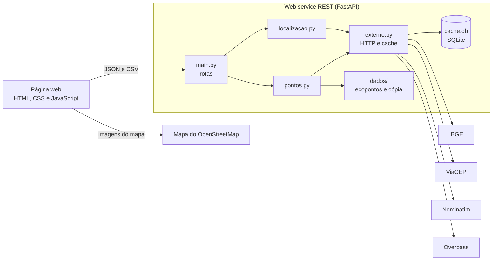
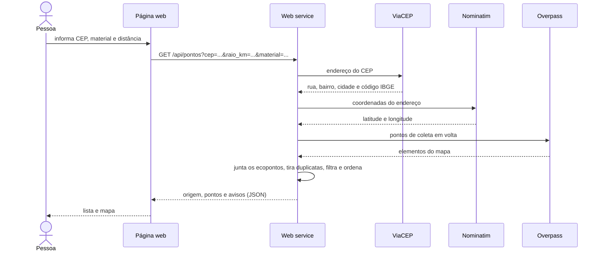
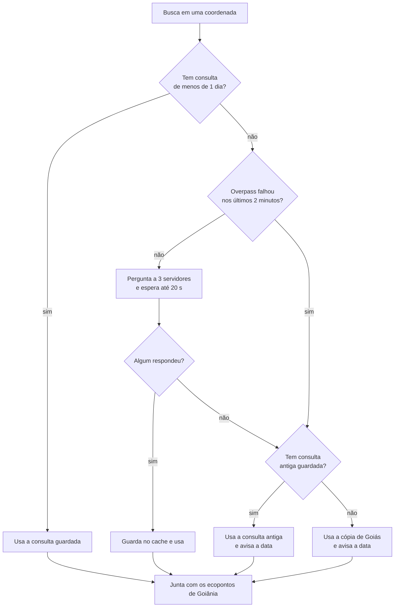
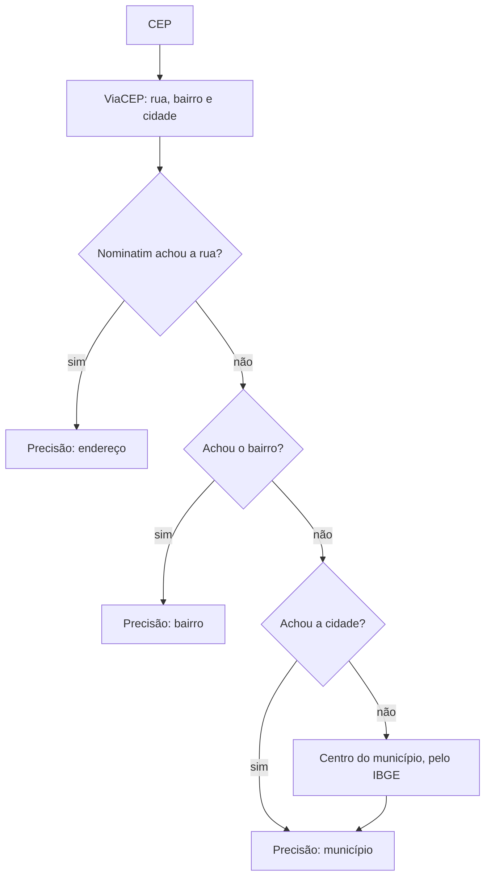

# Diagramas

Em Mermaid: o GitHub desenha direto, e em [mermaid.live](https://mermaid.live) dá para exportar a imagem para o relatório.

## Componentes

## Busca por CEP

## De onde vêm os pontos

## Do CEP até as coordenadas

