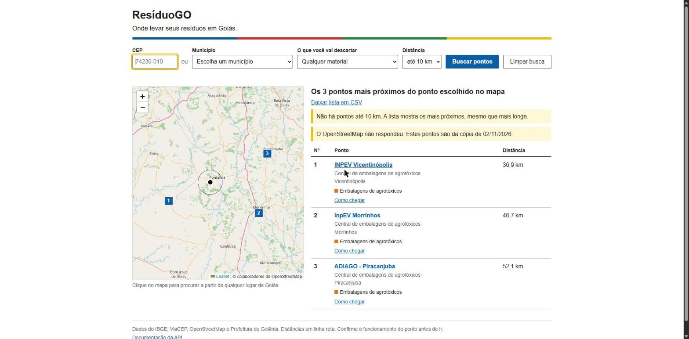
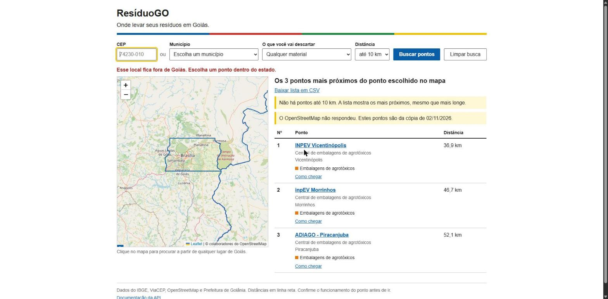

# Telas

## Tela inicial

O mapa já abre com o contorno de Goiás. A pessoa informa um CEP, escolhe um município ou clica no mapa. Os municípios aparecem agrupados pelas regiões do IBGE.

## Resultado da busca

Pontos do mais perto para o mais longe, com o mesmo número na lista e no mapa. O círculo mostra a distância escolhida. O aviso em amarelo aparece quando o OpenStreetMap não responde e a busca usa a cópia guardada no projeto.

## Filtro por material e seleção de um ponto

Mudar o material refaz a busca. Com "Eletrônicos e eletrodomésticos", as centrais de agrotóxicos saem da lista. Quem não informa os materiais continua aparecendo, com um aviso para confirmar antes de ir. Clicar no nome destaca o ponto na lista e no mapa.

## Clique no mapa

Clicar no mapa procura a partir daquele lugar. Sem nenhum ponto na distância escolhida, a lista mostra os 3 mais próximos do estado, e o mapa se ajusta para mostrar todos.

## Tratamento de erro

A mensagem de erro vem da API e diz o que fazer. A lista anterior continua na tela. No exemplo, um clique em Brasília, fora de Goiás.

