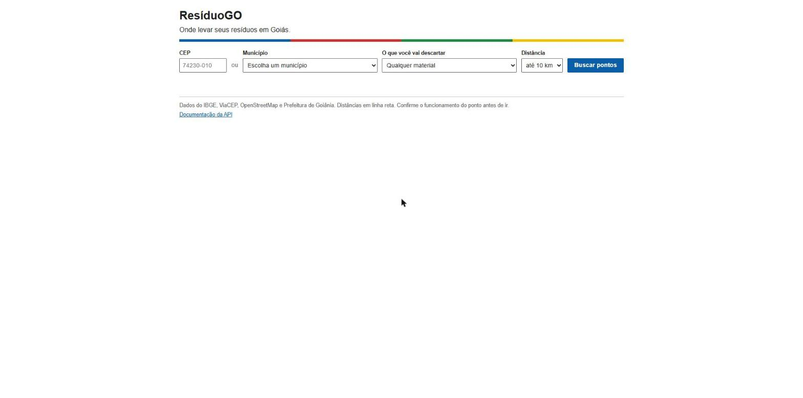
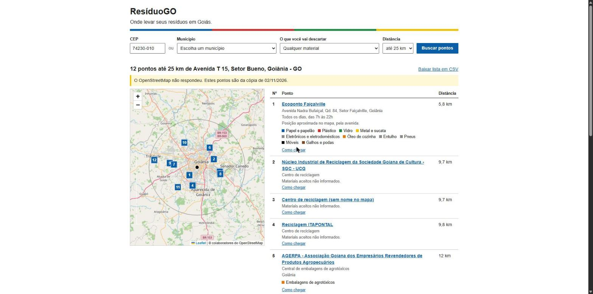
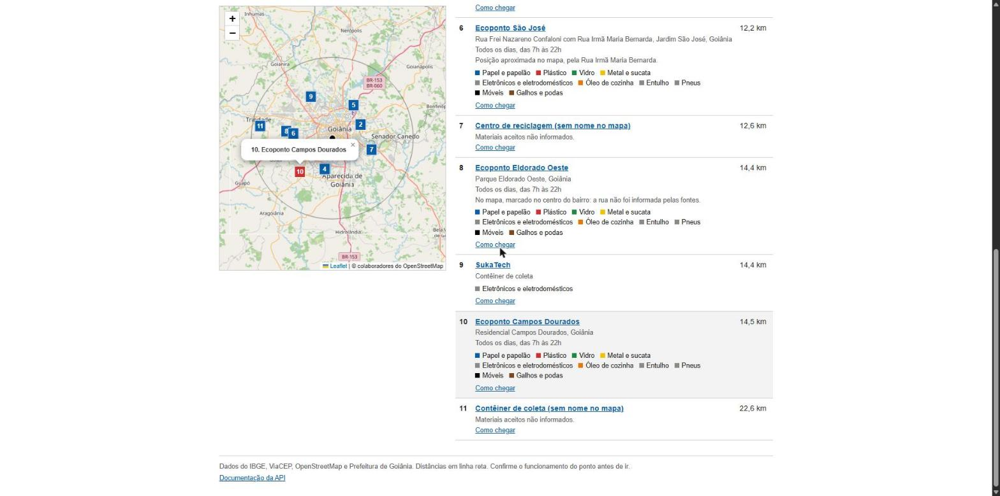
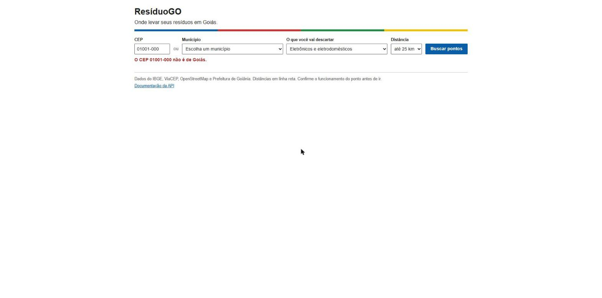

# Telas

## Tela inicial

A pessoa informa um CEP ou escolhe um município, e pode filtrar pelo material e pela distância. Os municípios aparecem agrupados pelas regiões do IBGE.

## Resultado da busca

Pontos do mais perto para o mais longe, com o mesmo número na lista e no mapa. O círculo mostra a distância escolhida. O aviso em amarelo aparece quando o OpenStreetMap não responde e a busca usa a cópia guardada no projeto.

## Filtro por material e seleção de um ponto

Com o filtro "Eletrônicos e eletrodomésticos", as centrais de agrotóxicos saem da lista. Quem não informa os materiais continua aparecendo, com um aviso para confirmar antes de ir. Clicar no nome destaca o ponto na lista e no mapa.

## Tratamento de erro

A mensagem de erro vem da API e diz o que fazer. No exemplo, um CEP de São Paulo.

